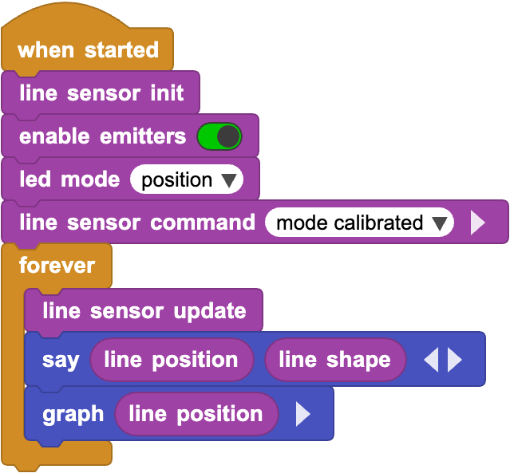

LMS Line Sensor
===============

Software and firmware for the eight-channel LMS reflectance line sensor
(CH32V203). The board speaks I2C, UART uRemote, and USB CDC uRemote.

**Current firmware version: 5.7**

Firmware, flashing, packet layout, EEPROM, LED modes, and the low-level command
tables are maintained in the repository file ``firmware/README.md``. This page
covers software usage and links into the Python and protocol API docs.

Flash firmware
--------------

1. Connect the line sensor to your PC with USB.
2. Press **RESET** twice quickly until a **CH32V UF2** drive appears.
3. Drag ``firmware/firmware_ch32_line_v5_7.uf2`` onto that drive.
4. Wait for the drive to disappear. Unplug and replug USB if NeoPixels do not scan.

Black or white line
-------------------

Firmware 5.6 and later support both line types. The default is a **black line
on a light surface**; no setup is needed for that case. For a white line on a
dark surface, call ``sensor.blackline(False)`` and then recalibrate.

In white-line mode the firmware inverts every channel (``255 - value``) before
calibration, position, and shape processing, so line-following code written for
a black line works unchanged. The setting is not stored in EEPROM: the sensor
returns to black-line mode at power-up, so call ``blackline()`` again after
every start. Calibration limits belong to one polarity, so recalibrate after
changing it. ``blackline()`` without an argument returns the current setting
on ``LineSensorUR``.

Web dashboard
-------------

Hosted UI (Chrome or Edge, Web Serial)::

   https://linesensor.antonsmindstorms.com

Sources live in ``web/``. See ``web/README.md``. Close the dashboard before
opening the USB port from another program.

Choose a software path
----------------------

* **USB from a PC** — ``usb/`` Python client, or the web dashboard above.
* **Pybricks, sensor on the hub UART** — ``LineSensorUR`` in
  ``micropython/line_sensor_pybricks.py``.
* **Pybricks + LMS-ESP32 + I2C sensor** — ``LineSensorUR`` on the hub and
  ``LineSensorURServer`` on the ESP32 (``micropython/line_sensor_ur_server.py``).
* **MicroPython on LMS-ESP32 only** — ``LineSensorI2C`` in
  ``micropython/line_sensor.py``.
* **MicroBlocks** — ``microblocks/LMS Line Sensor.ubl``.

Performance (approximate)
-------------------------

Indicative cycle times for reading eight sensor channels (wiring and hub load
vary):

.. list-table::
   :header-rows: 1

   * - Setup
     - Approximate cycle
   * - LMS-ESP32 I2C @ 400 kHz
     - 1.3 ms
   * - USB to PC (uRemote)
     - 1.5 ms
   * - LMS-ESP32 I2C @ 100 kHz
     - 2.3 ms
   * - EV3 UART (direct)
     - 4 ms (``sensors()`` ~5.2 ms when reading 13 bytes)
   * - SPIKE Prime UART (direct)
     - 8.2 ms
   * - EV3 I2C
     - 10 ms
   * - Prime via LMS-ESP32 ``LineSensorURServer`` (uRemote) and I2C
     - 14 ms

PUPRemote (Prime ← LMS-ESP32 I2C) can show ~2.5 ms per hub poll while the ESP32
needs ~5 ms to publish a new sample, so the hub often re-reads unchanged values.

uRemote framing is the main overhead versus I2C: about 33 bytes on the wire for
13 payload bytes. Plain I2C and a PUPRemote ``8B`` channel do not add that
framing.

Usage
-----

MicroPython with I2C
********************

.. code-block:: python

   from time import sleep
   from line_sensor import LineSensorI2C

   sensor = LineSensorI2C(scl_pin=4, sda_pin=5, device_addr=51)
   sensor.ir_power(True)
   sensor.load_calibration()
   sensor.mode_calibrated()

   while True:
       print(sensor.position(), sensor.derivative(), sensor.shape())
       sleep(0.1)

Pybricks with uRemote
*********************

Works for a direct UART cable to the sensor, or for an LMS-ESP32 running
``LineSensorURServer``.

.. code-block:: python

   from pybricks.parameters import Port
   from line_sensor_pybricks import LineSensorUR

   sensor = LineSensorUR(Port.B)
   sensor.ir_power(True)
   sensor.load_calibration()
   sensor.mode_calibrated()

   while True:
       print(sensor.position(), sensor.derivative(), sensor.shape())
       wait(100)

Prefer these high-level names in new code: ``ir_power``, ``leds``,
``save_calibration``, ``load_calibration``. Compatibility aliases
``set_emitter`` and ``get_cal_min``/``get_cal_max``/``set_cal_min``/``set_cal_max``
exist on both classes; ``LineSensorI2C`` also accepts ``led_mode``,
``rgb_mode`` and ``set_neopixel``.

Line polarity: see *Black or white line* above.

Useful constants:

- ``MODE_RAW`` and ``MODE_CALIBRATED``
- ``LEDS_OFF``, ``LEDS_VALUES``, ``LEDS_VALUES_INVERTED``, ``LEDS_POSITION``
- ``POSITION``, ``MIN``, ``MAX``, ``DERIVATIVE``, ``SHAPE`` for ``data()``
- ``SHAPE_STRAIGHT``, ``SHAPE_T``, ``SHAPE_L_LEFT``, ``SHAPE_L_RIGHT``,
  ``SHAPE_Y``, ``SHAPE_NONE``

LMS-ESP32 uRemote server
************************

.. code-block:: python

   from line_sensor_ur_server import LineSensorURServer

   ls = LineSensorURServer()
   while True:
       ls.process()

See ``examples/lms-esp32-ur-server/`` for a paired hub script.

MicroBlocks
***********

Python USB client
-----------------

.. code-block:: console

   cd usb
   python -m pip install -r requirements.txt
   python read_line_sensor.py

Works on Windows, macOS, and Linux. See ``usb/README.md``.

API reference
-------------

Python module reference
***********************

.. automodule:: line_sensor
   :members:
   :undoc-members:
   :show-inheritance:

Line sensor hardware register and native commands
*************************************************

.. toctree::
   :maxdepth: 2
   :caption: Line sensor APIs

   API/lms-line-sensor-i2c-api
   API/lms-line-sensor-uremote-api
